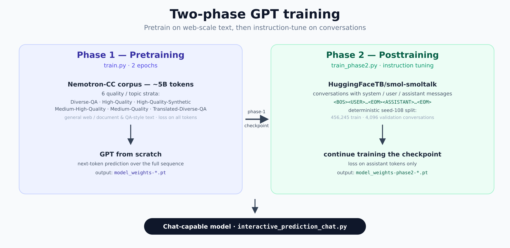

# GPT

Train a GPT language model in two phases—pretraining on a subset of the Nemotron-CC dataset and instruction-tuning on conversational data.
This code is heavily inspired by the nanoGPT code (Karpathy).

## Two-phase training



Training happens in two phases:

- **Phase 1 (pretraining)** — trains on the local Nemotron-CC text corpus (5,000,028,820 tokens across six quality/topic strata: Diverse-QA, High-Quality, High-Quality-Synthetic, Medium-High-Quality, Medium-Quality, and Translated-Diverse-QA) via `start_training.sh` and `train.py` (or `train_singlegpu.py` for a simpler single-GPU version). It is general web/document and QA-style text rather than structured chat supervision, trained for two epochs (10,000,057,640 token presentations).
- **Phase 2 (posttraining)** — instruction-tunes the phase-1 checkpoint on `HuggingFaceTB/smol-smoltalk`, a conversational dataset with system/user/assistant messages. The data is deterministically split (seed 108) into 456,245 training conversations and 4,096 validation conversations, serialized as `<BOS><USER>...<EOM><ASSISTANT>...<EOM>`, with only assistant tokens contributing to the loss.

## Setup

Install the Python dependencies:

```bash
uv sync
```

If you have a pre-built `tokenizer.zip`, unzip it into the cache directory
(`~/.cache/gpt` by default, or `$GPT_CACHE_DIR`/`$GPT_TOKENIZER_DIR` if set)
so its contents land at `<cache_dir>/tokenizer/`:

```bash
unzip tokenizer.zip -d ~/.cache/gpt
```

`prepare.py` will detect the existing tokenizer files and skip training a new
one.

Place `train.parquet` and `validation.parquet` in the `DATA_DIR` configured in `prepare.py`, then train the tokenizer once:

```bash
uv run python prepare.py
```

### Building the phase-1 pretraining corpus

`prepare.py`'s `train.parquet`/`validation.parquet` are only a small sample used to
train the tokenizer. Phase-1 training itself reads from a separate, much larger
directory (`--data-dir`, default `~/data/nemotron_cc_5b`) containing one
subdirectory per quality/topic stratum, each holding Parquet shards. Build it
with `extract_nemotron_cc.py`, which streams the gated `nvidia/Nemotron-CC-v2`
dataset from Hugging Face (accept its terms on HF, then `hf auth login` or set
`HF_TOKEN`) and tokenizes on the fly using the tokenizer trained above:

```bash
uv run python extract_nemotron_cc.py \
    --target-tokens 5_000_000_000 \
    --output-dir ~/data/nemotron_cc_5b
```

This is a separate, one-time step from the tokenizer sample above — don't confuse
the two `DATA_DIR`-like paths: `~/data/nemotron_cc` (flat, tokenizer only) vs.
`~/data/nemotron_cc_5b` (per-stratum, actual pretraining data).

## Pretraining (phase 1) -- this phase is expensive and we therefore provided a trained model below.

Run single-GPU training:

```bash
uv run python train_singlegpu.py --model 135M --wandb 0
```

Training saves a `model_weights-*.pt` checkpoint in the project directory by default.

## Posttraining (phase 2)

Phase 2 continues training from a phase-1 checkpoint on `HuggingFaceTB/smol-smoltalk`
instruction data. By default it picks up the checkpoint named by `DEFAULT_CHECKPOINT`
in `start_training_phase2.sh`; point `CHECKPOINT` at a different phase-1
checkpoint if needed:

```bash
CHECKPOINT=/path/to/phase1_checkpoint.pt \
NUM_GPUS=4 \
./start_training_phase2.sh
```

If `$DATA_DIR/smol-smoltalk/train.parquet` doesn't exist yet (`DATA_DIR` defaults
to `$HF_HOME/gpt/smol-smoltalk-v2`), `start_training_phase2.sh`
automatically formats and tokenizes the *entire* SmolTalk train split for you
(the download/format logic is inline near the top of the script), with no
held-out validation set.

To instead get the deterministic seed-108 split described above (456,245
training / 4,096 validation conversations), run `split_phase2_data.py`
**before** `start_training_phase2.sh` on a copy of the dataset already
tokenized into this repo's chat schema (`input_ids`/`loss_mask`/`num_tokens` —
the same schema `start_training_phase2.sh`'s inline formatting step produces;
adapt that step to write to a temporary file first):

```bash
uv run python split_phase2_data.py \
    --source /path/to/smol-smoltalk-tokenized-full.parquet \
    --output-dir "${HF_HOME:-$HOME/.cache/huggingface}/gpt/smol-smoltalk-v2"
```

This writes `$DATA_DIR/smol-smoltalk/train.parquet` and
`$DATA_DIR/validation.parquet` directly, so `start_training_phase2.sh` skips its
own auto-format step and picks up `$DATA_DIR/validation.parquet` as
`--assistant-val-file` automatically.

Configure `DATA_DIR`, `VAL_FILE`, `EPOCHS`, and the per-parameter-group
learning rates (`MATRIX_LR`, `EMBEDDING_LR`, `UNEMBEDDING_LR`, `SCALAR_LR`) as
environment variables if the defaults in the script don't fit your run.

Like phase 1, this saves a `model_weights-phase2-*.pt` checkpoint in the
project directory.

## Downloading trained models

Model phase 1:
https://drive.switch.ch/index.php/s/Ce9XFqgbHGbeGs7

Model phase 2:
https://drive.switch.ch/index.php/s/eCtt8a5eXJL8GBz

## Inference

Generate once with the default checkpoint:

```bash
./run_prediction.sh --prompt "The history of artificial intelligence began"
```

Start an interactive session that loads the model once and accepts prompts continuously:

```bash
uv run python interactive_prediction.py \
  --checkpoint model_weights-135M-phase1.pt
```

For a phase-2 checkpoint, use the chat-formatted interactive variant. It adds
the phase-2 user/assistant role and end-of-message tokens automatically and
stops when the assistant end-of-message token is generated:

```bash
uv run python interactive_prediction_chat.py \
  --checkpoint model_weights-135M-phase2.pt \
  --num-tokens 200 \
  --temperature 0.8
```

The checkpoint above is an example phase-2 checkpoint; substitute your own
run's checkpoint filename as needed. For ordinary text continuation, or for
phase-1 checkpoints, use `interactive_prediction.py` as shown below.

Use another checkpoint or generation settings if desired:

```bash
uv run python interactive_prediction.py \
  --checkpoint model_weights-135M-phase1.pt \
  --num-tokens 100 \
  --temperature 0.8 \
  --seed 42
```

